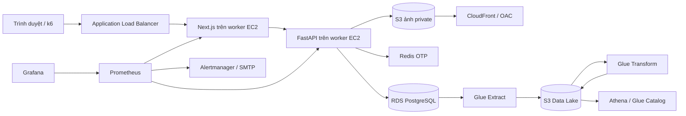

# COCO — E-commerce Platform with Data Pipeline on AWS

COCO là dự án thương mại điện tử gồm frontend Next.js, backend FastAPI và
pipeline phân tích dữ liệu PostgreSQL → S3 → Athena. Hạ tầng AWS được khai báo
bằng Terraform; ứng dụng chạy trên Kubernetes **kubeadm tự quản lý trên EC2**.

README này là điểm bắt đầu cho môi trường **dev**. Các lệnh mặc định chạy từ
**thư mục gốc repo trên máy local/WSL**, trừ khối ghi rõ chạy bên trong EC2.
Tài liệu mô tả mã và script hiện có, không phải xác nhận mọi bước đã được
kiểm thử thành công trên AWS.

## 1. Kiến trúc



Terraform quản lý VPC, subnet, NAT Gateway, Security Group, IAM, EC2/ASG, ALB,
RDS, S3, ECR, CloudFront, Glue và CloudWatch. Bootstrap EC2 cài Kubernetes,
Flannel, định danh node/AZ và cơ chế pull image ECR. Các script riêng triển khai
web, Metrics Server, EBS CSI, monitoring và Cluster Autoscaler qua SSM.

| Thành phần | Cấu hình dev trong source |
| --- | --- |
| Region | `ap-southeast-1` — Singapore |
| AWS account dùng bởi script dev | `858525799322` |
| Kubernetes | 1 control plane; ban đầu 2 worker ở 2 AZ |
| Worker EC2 | `t3.medium`; ASG min 2, desired ban đầu 2, max 4 |
| Frontend | Next.js, TypeScript, Node.js 24; HPA 2–4 Pod |
| Backend | FastAPI, SQLAlchemy, Python 3.13; HPA 2–10 Pod |
| Database | RDS PostgreSQL, database `coco_marketplace` |
| Ảnh | S3 private; delivery theo cấu hình backend/CloudFront |
| Monitoring | Prometheus, Grafana, Alertmanager, node-exporter, kube-state-metrics |
| Persistent storage monitoring | EBS CSI, StorageClass `coco-monitoring-gp3` |
| ETL | Glue Extract/Transform, S3 Data Lake, Glue Catalog, Athena |

HPA điều chỉnh số **Pod** theo CPU; Cluster Autoscaler điều chỉnh số **worker**
khi cần thêm chỗ chạy Pod. Số node tổng cộng bao gồm cả control plane:
**3 node = 1 control plane + 2 worker**. Tăng Pod không bắt buộc tăng worker.

## 2. Cấu trúc repo và tài liệu

| Đường dẫn | Nội dung / hướng dẫn |
| --- | --- |
| [`frontend/`](frontend/) | [Giao diện Next.js](frontend/README.md), Dockerfile và HTTP metrics frontend |
| [`backend/`](backend/) | [API FastAPI](backend/README.md), xác thực, nghiệp vụ, storage và metrics |
| [`sql/`](sql/) | [Schema và dữ liệu nguồn](sql/README.md): `marketplace_schema.sql`, `example_data.sql` |
| [`data health/`](<data health/>) | Ảnh nguồn `ProductImages/` và `logo/` để import lên S3 |
| [`terraform/`](terraform/) | [Hạ tầng](terraform/README.md), modules và environments dev/prod |
| [`k8s/`](k8s/) | [Kubernetes](k8s/README.md), base, overlays, HPA, CSI và monitoring |
| [`scripts/`](scripts/) | [Các lệnh dùng lại](scripts/README.md) cho build, deploy, ETL, lifecycle |
| [`etl/`](etl/) | [Pipeline và báo cáo](etl/README.md) |
| [`tests/k6/`](tests/k6/) | [Demo tải HTTP và quan sát scaling](tests/k6/README.md) |
| [`docs/`](docs/) | Tài liệu cấu hình, API và luồng chức năng |
| `artifacts/deploy/dev/` | File render, Secret và tiến độ local; đã gitignore |

`infra/` và `etl/glue_test/` không phải luồng triển khai chính trong README này.
Ưu tiên Compose và bản render deployment hiện tại khi tài liệu thành phần còn
ghi chú về các giai đoạn phát triển trước.

## 3. Công cụ và cấu hình

Để chạy bằng Docker cần Docker Engine/Desktop và Docker Compose. Trên WSL,
bật integration cho đúng distro và bảo đảm `docker info` có phần Server.

Để kiểm tra source và triển khai AWS cần:

- Bash và Python 3 trên Linux/WSL; backend dùng Python 3.13 qua `uv`/Docker.
- Node.js **24**, npm và `uv`.
- Terraform **>= 1.7** để dùng cả mock-provider tests; AWS CLI có credential hợp lệ.
- `kubectl`, Helm **3**, PostgreSQL client `psql`, Session Manager plugin.
- Docker đang chạy khi build image hoặc dùng k6 qua Docker.

Root `.env` dùng cho cấu hình local và thông tin SMTP khi chuẩn bị release.
Xem [cấu hình env/Docker](docs/docker-release.md). `.env.example` chỉ là điểm bắt
đầu; phải bổ sung cấu hình ứng dụng, khóa xác thực, SMTP/storage phù hợp trước
khi sử dụng chức năng tương ứng. Không đưa mật khẩu hoặc AWS access key vào Git.

```bash
# Chỉ tạo .env khi chưa có; không ghi đè cấu hình đang dùng.
if [ ! -f .env ]; then
  cp .env.example .env
fi
```

Các script AWS dev kiểm tra account và dùng region `ap-southeast-1`. Nếu dùng
profile riêng, đặt `AWS_PROFILE` trước khi chạy. Terraform state và file tiến độ
local cần được giữ lại để quản lý đúng tài nguyên đã tạo.

## 4. Chạy local bằng Docker Compose

Repo dùng chung **`docker-compose.yaml`**. Local gồm PostgreSQL, Redis OTP,
backend và frontend; profile `ec2` có nginx dành cho cách chạy Compose trên EC2,
khác với luồng AWS Kubernetes bên dưới.

### Bước 1 — Khởi động database và Redis

```bash
docker compose up -d --wait postgres otp-redis
```

Compose không mount `database/init` và không tự nhập bảng/dữ liệu ứng dụng.
Backend không tự chạy `create_all`, migration hoặc seed để chữa thiếu bảng.

### Bước 2 — Chuẩn bị schema và dữ liệu

Nếu DB local đã có bảng/dữ liệu, **bỏ qua bước nhập lại**. Với DB local mới,
review hai file SQL rồi chủ động nhập:

```bash
docker compose exec -T postgres sh -c \
  'exec psql -U "$POSTGRES_USER" -d "$POSTGRES_DB" -v ON_ERROR_STOP=1' \
  < sql/marketplace_schema.sql

docker compose exec -T postgres sh -c \
  'exec psql -U "$POSTGRES_USER" -d "$POSTGRES_DB" -v ON_ERROR_STOP=1' \
  < sql/example_data.sql
```

Các file SQL không phải migration idempotent. Không chạy lại để ghi đè DB đang
có dữ liệu. Xem [hướng dẫn SQL](sql/README.md) và đối chiếu tên database đích;
Compose mặc định dùng `marketplace_db`, RDS dev dùng `coco_marketplace`.

### Bước 3 — Build và chạy web

```bash
docker compose build backend frontend
docker compose up -d --wait --wait-timeout 180 backend frontend
docker compose ps
```

| Địa chỉ local mặc định | Mục đích |
| --- | --- |
| `http://localhost:3001` | Frontend |
| `http://localhost:8000/docs` | API docs khi chế độ ứng dụng cho phép |
| `http://localhost:8000/health/live` | Backend process sống |
| `http://localhost:8000/health/ready` | Backend sẵn sàng phục vụ |

Nếu backend unhealthy, đọc log trước khi recreate:

```bash
docker compose logs --tail=100 backend postgres otp-redis
```

Readiness 503 có thể liên quan DB, schema hoặc Redis. Frontend chờ backend
healthy; không đổi health check thành luôn thành công để bỏ qua lỗi.

Muốn dừng local và giữ volume database:

```bash
docker compose down
```

Không thêm `-v` nếu muốn giữ dữ liệu PostgreSQL local.

## 5. Kiểm tra trước khi triển khai

```bash
bash scripts/check-release.sh
```

Script kiểm tra shell, unit tests của scripts, một nhóm backend tests, frontend
tests/lint/typecheck và Terraform validate/mock tests. Nó không triển khai AWS,
build Docker hoặc chạy SQL vào DB nghiệp vụ. Có thể tải dependency/provider;
cần các công cụ và mạng phù hợp. Kết quả pass không thay thế thử nghiệm AWS.

## 6. Triển khai hoặc cập nhật AWS dev

### Hạ tầng mới và quy trình thủ công

Theo [Terraform dev](terraform/environments/dev/README.md):

```bash
bash scripts/aws/plan-dev.sh
terraform -chdir=terraform/environments/dev show -no-color dev.tfplan
```

Chỉ sau khi review đúng plan mới áp dụng:

```bash
bash scripts/aws/apply-dev.sh
```

Terraform tạo hạ tầng, không đồng nghĩa web, monitoring và ETL đã triển khai
xong. Tiếp tục theo [runbook web dev](k8s/overlays/dev/README.md),
[monitoring](k8s/monitoring/README.md), [autoscaling](k8s/autoscaling/README.md)
và [ETL](etl/README.md). Luồng web thủ công yêu cầu chuẩn bị schema RDS trước;
dữ liệu DB local không tự xuất hiện trên AWS.

### Cập nhật code trên AWS đang chạy

```bash
export COCO_IMAGE_TAG="dev-$(date -u +%Y%m%d%H%M%S)"
bash scripts/aws/build-push-dev.sh "$COCO_IMAGE_TAG"
python3 scripts/aws/prepare-dev-release.py --tag "$COCO_IMAGE_TAG"
```

Tiếp tục bước lưu Secret và task deploy trong [runbook web dev](k8s/overlays/dev/README.md).
Dùng cùng tag cho cả hai image, render lại từ output hiện tại và chờ từng SSM
command **Success**. Không deploy manifest cũ còn endpoint hoặc tag của lần trước.
Không dùng lệnh `up` ở phần lifecycle để cập nhật stack đang chạy.

### Xem node/Pod trong cluster private

Từ local, tìm control plane hiện tại rồi mở phiên SSM:

```bash
COCO_CONTROL_PLANE_ID="$(aws ec2 describe-instances \
  --region ap-southeast-1 \
  --filters 'Name=tag:Name,Values=ecommerce-dev-control-plane' \
            'Name=instance-state-name,Values=running' \
  --query 'Reservations[].Instances[].InstanceId' --output text --no-cli-pager)"

aws ssm start-session --region ap-southeast-1 --target "$COCO_CONTROL_PLANE_ID"
```

Các lệnh sau chạy **bên trong EC2 control plane**:

```bash
sudo kubectl --kubeconfig=/etc/kubernetes/admin.conf get nodes -o wide
sudo kubectl --kubeconfig=/etc/kubernetes/admin.conf -n coco get pods,svc,hpa
sudo kubectl --kubeconfig=/etc/kubernetes/admin.conf -n coco top pods
```

File `/etc/kubernetes/admin.conf` nằm trên control plane, không phải máy local.
Không dùng Instance ID cũ sau destroy; nhấn `Ctrl+D` để thoát phiên SSM.

## 7. Ảnh sản phẩm và logo shop

Ảnh nguồn nằm trong `data health/ProductImages/` và `data health/logo/`.
Giữ nguyên key phân biệt hoa/thường: `ProductImages/...` và `logo/...`.

```bash
bash scripts/aws/upload-catalog-images.sh --dry-run
# Sau khi xem đúng đường dẫn đích:
bash scripts/aws/upload-catalog-images.sh --upload
```

Bucket ảnh private; không mở public bucket để chữa lỗi hiển thị. Backend cấp URL
theo chính sách delivery; CloudFront/OAC đọc các prefix được cho phép. URL S3
trực tiếp có thể không truy cập công khai dù object đã tồn tại.
Xem [S3 images](docs/s3-images.md).

## 8. Monitoring và demo autoscaling

Dashboard **Coco - Application** gồm:

- Throughput frontend/backend: hai đường **request/giây**, không phải người dùng duy nhất.
- P95 latency: từ histogram thời gian phản hồi của từng tầng.
- Error Rate: tỷ lệ phản hồi HTTP **5xx** của từng tầng.
- CPU từng Pod và worker; Pod desired/available, HPA, worker Ready và Pod Pending.

Prometheus lấy metrics backend và frontend qua ServiceMonitor. Metrics frontend
cần image có preload `frontend/observability/`; đổi dashboard không tự thêm số
liệu vào image cũ. Không cộng request frontend và backend thành tổng khách truy cập.

Cập nhật riêng dashboard từ local:

```bash
python3 scripts/aws/run-dev-task.py dashboards
```

Dùng lệnh `status` được in ra, đợi **Success**, rồi refresh Grafana. Grafana là
service private; giữ phiên port-forward trên EC2 và tunnel SSM local theo
[runbook monitoring](k8s/monitoring/README.md). Khi tunnel local dùng port 3002,
mở `http://localhost:3002/d/coco-application`.

Demo HTTP chạy từ local qua ALB, không cài k6 lên worker:

```bash
bash scripts/aws/demo-k6-dev.sh smoke

# Chỉ tăng tải sau khi smoke đạt:
PEAK_VUS=50 HOLD_SECONDS=600 bash scripts/aws/demo-k6-dev.sh scale
```

`PEAK_VUS=50` là tối đa 50 người dùng ảo đồng thời. `HOLD_SECONDS=600` giữ mức
đỉnh 10 phút; tổng kịch bản khoảng 14 phút 30 giây, chưa tính graceful stop.
Script tăng tải dần, gọi GET trang chủ/catalog rồi giảm về 0. Đây là HTTP test,
không phải trình duyệt tự tải toàn bộ ảnh/CSS/JavaScript. `Ctrl+C` tại terminal k6
dừng tải, không xóa Pod hoặc worker.

Chỉ kết luận scaling sau khi quan sát CPU, HPA, Pending và sự kiện node. Nếu hai
worker vẫn đủ chỗ thì Pod có thể tăng mà worker không tăng. Scale-down cần thời
gian ổn định; workload demo `worker-pressure` còn chạy có thể giữ worker ở mức cao.
Xem [kịch bản và nghiệm thu k6](tests/k6/README.md).

## 9. Pipeline ETL

Pipeline dùng Glue Extract đọc PostgreSQL, Glue Transform ghi các lớp dữ liệu
trong S3 Data Lake, sau đó publish Glue Catalog và query báo cáo bằng Athena.
Tài nguyên Glue đã tồn tại không đồng nghĩa data lake đã có dữ liệu.

```bash
python3 scripts/aws/prepare-etl-dev.py
bash scripts/aws/etl-dev.sh check
bash scripts/aws/etl-dev.sh upload
bash scripts/aws/etl-dev.sh setup
bash scripts/aws/etl-dev.sh finish --timeout-seconds 7200
```

Luồng trên dành cho workflow manual; nếu đã có scheduled trigger, xem quy trình
đổi chế độ trong [ETL README](etl/README.md), không tạo hai starting trigger trong
cùng workflow. `finish` có thể chạy một batch mới có phí hoặc tiếp tục batch đã
lưu, chờ extract/transform, publish Catalog và kiểm tra báo cáo. Khi timeout,
tiếp tục đúng Run ID; không tự tạo thêm batch để chữa lỗi chờ.

Sau khi batch đạt và chủ động muốn bật lịch:

```bash
bash scripts/aws/etl-dev.sh enable-schedule --replace-start-trigger
```

Lịch dev trong source là **01:00 giờ Việt Nam** mỗi ngày, tương ứng
`cron(0 18 * * ? *)` UTC ngày hôm trước. ETL không tự sửa bảng/dữ liệu RDS nguồn.

## 10. Xóa dev không backup và dựng lại bằng một lệnh

Entry point: [`scripts/aws/dev-stack.sh`](scripts/aws/dev-stack.sh).
Đọc [điều kiện và quy trình lifecycle](scripts/aws/DEV-STACK.md) trước khi dùng.
Luồng này đã được chủ dự án cho phép nhập schema/demo vào **RDS mới do script tạo**;
không áp dụng quyền đó cho việc ghi đè một DB đang có dữ liệu.

Kiểm tra đầu vào local/account/Docker trước:

```bash
bash scripts/aws/dev-stack.sh check
```

**Lệnh dưới xóa dữ liệu dev thật, không backup:** RDS, tất cả version ảnh/data
lake S3, image ECR và các volume CSI thuộc phạm vi script quản lý.

```bash
bash scripts/aws/dev-stack.sh destroy --delete-data
```

Hôm cần dùng lại, bật Docker và chạy từ local:

```bash
bash scripts/aws/dev-stack.sh up
```

Lệnh `up` tạo hạ tầng, chờ cluster, nhập SQL nguồn vào RDS mới, build/push image,
tải ảnh local, triển khai web/monitoring/autoscaling, chạy batch ETL đầu tiên,
bật lịch rồi kiểm tra web. Nó không tự chạy demo tải lớn.

Giữ nguyên repo, SQL/ảnh local, `.env`, Terraform state/config và
`artifacts/deploy/dev/`, đặc biệt cấu hình/credential SMTP và Grafana. Đây là đầu
vào dựng mới; dữ liệu phát sinh trên AWS đã destroy không được khôi phục.
Tiến độ nằm trong `stack-lifecycle.json`, ETL receipt tách theo lần dựng mới.

Các script lifecycle **chưa được xác minh end-to-end trên AWS trong lúc viết**.
Chạy các kiểm tra trong [DEV-STACK.md](scripts/aws/DEV-STACK.md) trước khi xóa;
không coi một lệnh là bảo đảm không lỗi. Build, AWS và ETL vẫn cần thời gian chờ.
Grafana cần mở lại tunnel sau khi dựng xong. Script không quét xóa mọi tài nguyên
trong account hoặc bảo đảm hóa đơn lập tức bằng 0.

## 11. Phạm vi và nguyên tắc vận hành

- Cấu hình dev dùng HTTP qua ALB; không mang nguyên cấu hình này lên production.
- Repo có environment prod nhưng README này không xác nhận production đã được
  triển khai/nghiệm thu. Xem [Terraform prod](terraform/environments/prod/README.md)
  và [Kubernetes prod](k8s/overlays/prod/README.md) để review riêng.
- Một control plane EC2 là điểm phụ thuộc chung, chưa phải control plane HA.
- Không sửa Secret, schema hoặc health check chỉ để che lỗi readiness/metrics.
- Không xóa state, volume hoặc tái nhập SQL để chữa một lỗi triển khai chưa rõ nguyên nhân.
- Lệnh tạo tài nguyên, build/push, load test và ETL do chủ dự án chủ động chạy;
  kiểm tra/render thành công không đồng nghĩa hệ thống live đã được nghiệm thu.
